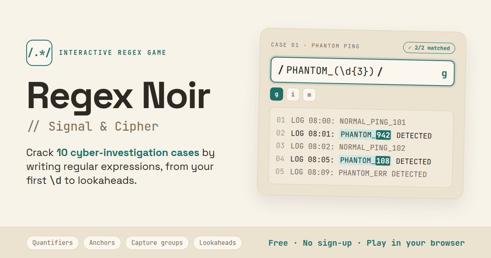
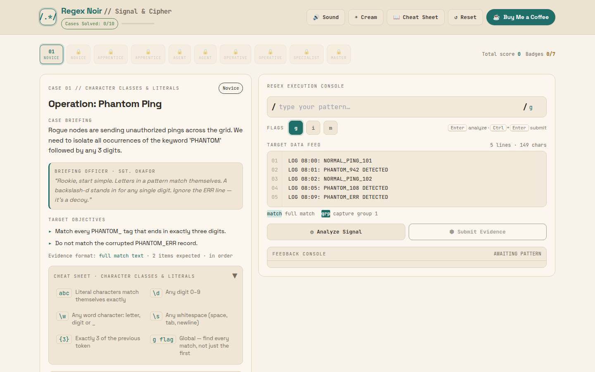
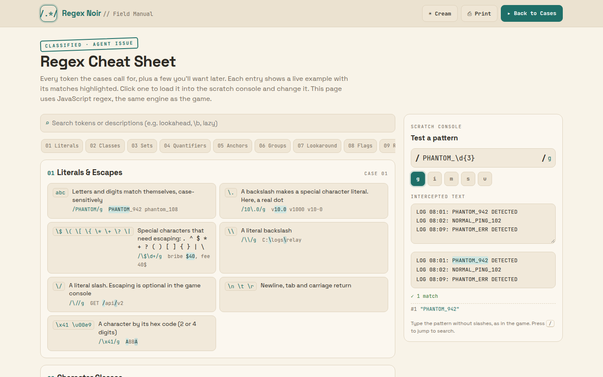

<div align="center">


# Regex Noir

**Learn regular expressions by solving cyber-noir investigation cases in your browser.**

[](https://wiks-sq.github.io/regex-noir/)
[](https://wiks-sq.github.io/regex-noir/cheatsheet.html)

[](https://github.com/wiks-sq/regex-noir/actions/workflows/pages.yml)
[](LICENSE)




</div>

## About

Regex Noir turns regular expressions into detective work. Each of the 10 cases hands you an intercepted log full of decoys and asks you to pull out exactly the right evidence with a single pattern. Your matches are highlighted live as you type, and wrong answers cost points, not progress.

It's one HTML file: no backend, no accounts and no build step. Progress is saved in your browser's `localStorage`.

## Features

- **10 cases, 10 concepts**: from literals and `\d` to backreferences, lazy matching and lookaheads, finishing with a timed master case.
- **Live feedback**: every match and capture group is highlighted in the data feed as you type, with plain-English syntax errors.
- **Scoring and badges**: misfires, hints and speed affect your score. Seven commendations, plus a downloadable *Master Cryptanalyst* emblem for finishing all ten cases.
- **Pattern explainer**: after each solve, your regex is broken down token by token.
- **[Regex cheat sheet](https://wiks-sq.github.io/regex-noir/cheatsheet.html)**: every token with a live, clickable example and a scratch console to try patterns.
- **Accessible**: keyboard shortcuts, a High Contrast theme, screen-reader live regions and `prefers-reduced-motion` support.
- **Private by design**: no analytics, no cookies, no server.

## Screenshots

| Case console | Cheat sheet |
|---|---|
|  |  |

## The cases

| # | Case | Concept | Rank |
|---|---|---|---|
| 01 | Operation: Phantom Ping | Character classes & literals | Novice |
| 02 | The Counterfeit Serials | Wildcards & quantifiers | Novice |
| 03 | Signatures in the Static | Anchors & word boundaries | Apprentice |
| 04 | Hash Ledger Audit | Character sets & ranges | Apprentice |
| 05 | Noise on the Wire | Negated sets | Agent |
| 06 | Echo Chamber | Capture groups & backreferences | Agent |
| 07 | Fault Lines | Optionality & alternation | Operative |
| 08 | The Dossier Dump | Non-capturing groups & lazy matching | Operative |
| 09 | Keys to the Kingdom | Positive & negative lookaheads | Specialist |
| 10 | Night Shift at Meridian | Master case (timed) | Master |

Cases unlock in order. Answers are deliberately not published here, so no spoilers.

## How to play

1. Read the case briefing and objectives on the left.
2. Type a pattern into the console (without slashes) and toggle the flags you need.
3. Press <kbd>Enter</kbd> to **Analyze Signal**. This is free and shows what your pattern matches.
4. Press <kbd>Ctrl</kbd>/<kbd>⌘</kbd> + <kbd>Enter</kbd> to **Submit Evidence**. You pass when your matches equal the expected evidence exactly, in order.

Stuck? Request a hint (−200 points), or after three misfires declassify the solution (−500).

## Run it locally

```bash
git clone https://github.com/wiks-sq/regex-noir.git
cd regex-noir
python3 -m http.server 8000
```

Then open <http://localhost:8000>. Opening `index.html` directly also works. The game loads React, Babel and Tailwind from CDNs, so the first load needs an internet connection.

## Development

The whole game lives in `index.html`: CSS, React components (compiled in the browser by Babel) and the case data. `cheatsheet.html` is a standalone page in plain HTML, CSS and JavaScript.

Check that every case's reference pattern still produces exactly the expected evidence, and that known wrong answers are rejected:

```bash
node tools/verify-cases.js
```

CI runs the same check on every push and pull request. See **[docs/DEVELOPMENT.md](docs/DEVELOPMENT.md)** for the file anatomy, case data schema, scoring rules, theming and how to add a case.

### Tech stack

| | |
|---|---|
| UI | React 18 (UMD) + Babel standalone, no bundler |
| Styling | Tailwind CSS (Play CDN) + CSS custom properties for themes |
| Fonts | JetBrains Mono, Space Grotesk (Google Fonts) |
| Hosting | GitHub Pages via GitHub Actions |

## Deployment

Pushes to `main` run [`.github/workflows/pages.yml`](.github/workflows/pages.yml). It verifies the cases, then publishes only the public files (`index.html`, `cheatsheet.html`, icons, `og-image.png`, `site.webmanifest`) to GitHub Pages. To host it elsewhere, upload those same files to any static host.

## Contributing

Issues and pull requests are welcome, whether that's a new case idea, a clearer explanation, an accessibility fix or a bug report.

1. Fork the repo and create a branch.
2. Make your change. If you touch case data, run `node tools/verify-cases.js`.
3. Open a pull request describing what changed and why.

Please don't post case solutions in public issues.

## License

[MIT](LICENSE)
